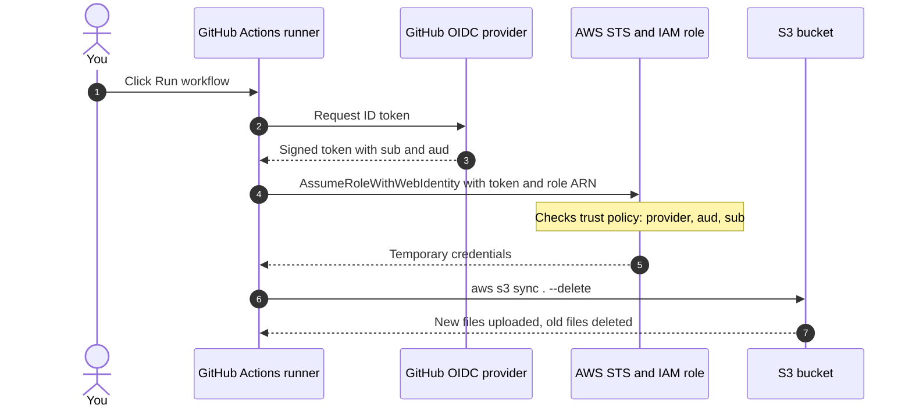
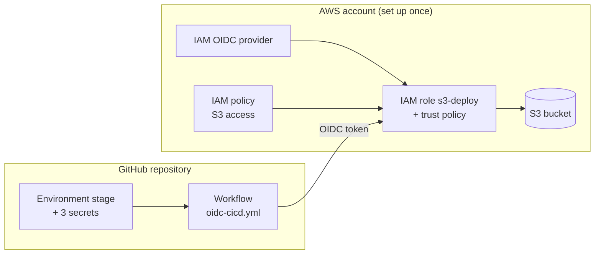

# Deploy to AWS S3 from GitHub Actions using OIDC

> No access keys. Manual deploy. Old files removed, new code uploaded.

## Contents

- [1. What you will build](#1-what-you-will-build)
- [2. How it works (real-life analogy)](#2-how-it-works-real-life-analogy)
- [3. Setup map](#3-setup-map)
- [4. Prerequisites](#4-prerequisites)
- [Step 1: Create the S3 bucket](#step-1-create-the-s3-bucket)
- [Step 2: Add GitHub as an OIDC provider in AWS](#step-2-add-github-as-an-oidc-provider-in-aws)
- [Step 3: Create the S3 permission policy](#step-3-create-the-s3-permission-policy)
- [Step 4: Create the IAM role and trust policy](#step-4-create-the-iam-role-and-trust-policy)
- [Step 5: Create the GitHub environment and secrets](#step-5-create-the-github-environment-and-secrets)
- [Step 6: Add the workflow file](#step-6-add-the-workflow-file)
- [Step 7: Run the deployment and verify](#step-7-run-the-deployment-and-verify)
- [How old files are removed](#how-old-files-are-removed)
- [Troubleshooting](#troubleshooting)
- [Security best practices](#security-best-practices)
- [Cost](#cost)
- [Maintenance](#maintenance)
- [Quick reference](#quick-reference)

## 1. What you will build

A manual deployment pipeline. You click **Run workflow** in GitHub Actions and your repository files are copied to an S3 bucket. Files that no longer exist in the repository are removed from S3.

- **No AWS access keys** are stored in GitHub. GitHub proves its identity to AWS with a short-lived OIDC token.
- **Manual trigger** (`workflow_dispatch`): nothing deploys until you press the button.
- **Clean sync**: new and changed files are uploaded, deleted files are removed (`--delete`).
- **Smart caching**: files get a 1-year cache header, while `index.html` is uploaded with `no-cache`.

## 2. How it works (real-life analogy)

Think of visiting a company office. You are not given a permanent key. You show an ID card, the security desk checks it against its list of trusted issuers, and then prints a temporary day pass for the rooms you are allowed to enter.

| Real life | In this setup |
|---|---|
| Company that issued your ID card | GitHub (OIDC provider `token.actions.githubusercontent.com`) |
| Your ID card | The OIDC token: a signed JWT containing `sub` and `aud` |
| Security desk | AWS STS (Security Token Service) |
| Desk's list of trusted ID issuers | IAM OIDC identity provider |
| Visitor rules: who may come in | IAM role trust policy (`sub` and `aud` conditions) |
| Day pass that expires | Temporary AWS credentials (about 1 hour) |
| The room you may enter | S3 bucket, limited by the IAM permission policy |



**Why this is safer:** there is no long-lived secret to leak. The temporary credentials expire by themselves, and the trust policy limits which repository and environment can use the role.

## 3. Setup map

You configure two sides once. AWS holds the provider, the permission policy and the role. GitHub holds the environment, the secrets and the workflow file.



## 4. Prerequisites

- An AWS account where you can create IAM roles and policies.
- A GitHub repository with Actions enabled (Settings > Actions > General > Allow all actions and reusable workflows).
- Your repository's **default branch** name (for example `master` or `main`). The workflow file must be on this branch.

## Step 1: Create the S3 bucket

1. Open AWS Console > **S3** > **Create bucket**.
2. Enter a unique bucket name and choose a region (for example `ap-south-1`).
3. Keep **Block Public Access** turned on unless you are hosting a public website from this bucket.
4. Recommended: turn on **Bucket Versioning** so files removed by `--delete` can be recovered.

> **Note:** Write down the bucket name and region. You need them in Step 5.

## Step 2: Add GitHub as an OIDC provider in AWS

1. Open AWS Console > **IAM** > **Identity providers** > **Add provider**.
2. Provider type: **OpenID Connect**.
3. Provider URL: `https://token.actions.githubusercontent.com`
4. Audience: `sts.amazonaws.com`
5. Click **Add provider**.

> **Note:** You do this once per AWS account. If the provider already exists, skip this step.

## Step 3: Create the S3 permission policy

Open IAM > **Policies** > **Create policy** > **JSON**, paste the policy below and name it `s3-deploy-policy`. Replace `YOUR-BUCKET-NAME` with your bucket.

```json
{
  "Version": "2012-10-17",
  "Statement": [
    {
      "Effect": "Allow",
      "Action": ["s3:ListBucket"],
      "Resource": "arn:aws:s3:::YOUR-BUCKET-NAME"
    },
    {
      "Effect": "Allow",
      "Action": ["s3:PutObject", "s3:GetObject", "s3:DeleteObject"],
      "Resource": "arn:aws:s3:::YOUR-BUCKET-NAME/*"
    }
  ]
}
```

> **Note:** `s3:ListBucket` applies to the bucket itself. The object actions apply to `/*`. `s3:DeleteObject` is required so old files can be removed.

## Step 4: Create the IAM role and trust policy

1. Open IAM > **Roles** > **Create role** > **Web identity**.
2. Identity provider: `token.actions.githubusercontent.com`. Audience: `sts.amazonaws.com`.
3. Attach the policy `s3-deploy-policy`.
4. Name the role `s3-deploy` and create it.
5. Open the role > **Trust relationships** > **Edit trust policy** and paste the policy below.

The `sub` condition is the most important line. It decides exactly which repository and environment may use the role. For a job that uses a GitHub environment, GitHub builds the value from the repository and the environment name. Some repositories receive the numeric owner and repository IDs inside it:

```text
Simple form (many guides) : repo:OWNER/REPO:environment:stage
Form GitHub may send      : repo:OWNER@OWNER_ID/REPO@REPO_ID:environment:stage
```

> **Warning:** If the `sub` in your trust policy is different from what GitHub sends, AWS returns: **Not authorized to perform sts:AssumeRoleWithWebIdentity**. Always copy the real value (next section) instead of guessing.

```json
{
  "Version": "2012-10-17",
  "Statement": [
    {
      "Effect": "Allow",
      "Principal": {
        "Federated": "arn:aws:iam::ACCOUNT_ID:oidc-provider/token.actions.githubusercontent.com"
      },
      "Action": "sts:AssumeRoleWithWebIdentity",
      "Condition": {
        "StringEquals": {
          "token.actions.githubusercontent.com:aud": "sts.amazonaws.com",
          "token.actions.githubusercontent.com:sub": "repo:OWNER@OWNER_ID/REPO@REPO_ID:environment:stage"
        }
      }
    }
  ]
}
```

### Find your exact sub value

Add this temporary step to the workflow, right after the checkout step. Run the workflow once and read the `sub` it prints. Copy it into the trust policy, then delete the step.

```yaml
      - name: Show OIDC subject
        run: |
          TOKEN=$(curl -s -H "Authorization: bearer $ACTIONS_ID_TOKEN_REQUEST_TOKEN" "$ACTIONS_ID_TOKEN_REQUEST_URL&audience=sts.amazonaws.com" | jq -r '.value')
          echo "$TOKEN" | cut -d. -f2 | base64 -d 2>/dev/null | jq '{sub, aud}'
```

You can also check the IDs yourself. Open `https://api.github.com/users/OWNER` and `https://api.github.com/repos/OWNER/REPO` in a browser and read the `id` field. The step prints only the claims, not the token, and the `sub` value is not secret.

## Step 5: Create the GitHub environment and secrets

1. In your repository open **Settings** > **Environments** > **New environment**.
2. Name it `stage`. The name must be exactly the same as `environment: stage` in the workflow.
3. Under **Environment secrets** add the three secrets below.
4. Optional: set **Deployment branches** to your default branch, and add **Required reviewers** for production environments.

| Secret name | Example value |
|---|---|
| `AWS_ROLE_ARN` | `arn:aws:iam::ACCOUNT_ID:role/s3-deploy` |
| `AWS_REGION` | `ap-south-1` |
| `S3_BUCKET_NAME` | `your-bucket-name` |

> **Note:** The role ARN, region and bucket name are identifiers, not credentials. Paste them with no spaces and no quotes. Save them as **Secrets** because the workflow reads `secrets.NAME`. If you save them as Variables you must use `vars.NAME` instead.

## Step 6: Add the workflow file

Create `.github/workflows/oidc-cicd.yml` at the root of the repository, on the default branch. Tip: use the GitHub web editor (**Add file** > **Create new file**) to avoid hidden tabs or odd characters that can appear when copying text, which make GitHub ignore the file.

```yaml
name: Sync Build to S3

on:
  workflow_dispatch:

permissions:
  id-token: write
  contents: read

jobs:
  deploy:
    runs-on: ubuntu-latest
    environment: stage

    steps:
      - name: Checkout repository
        uses: actions/checkout@v4

      - name: Configure AWS credentials (OIDC)
        uses: aws-actions/configure-aws-credentials@v4
        with:
          role-to-assume: ${{ secrets.AWS_ROLE_ARN }}
          aws-region: ${{ secrets.AWS_REGION }}

      - name: Sync static assets with long cache
        run: |
          aws s3 sync . s3://${{ secrets.S3_BUCKET_NAME }} \
            --delete \
            --exclude ".git/*" \
            --exclude ".github/*" \
            --exclude ".gitignore" \
            --exclude "README.md" \
            --exclude "LICENSE" \
            --exclude "index.html" \
            --cache-control "public,max-age=31536000,immutable"

      - name: Sync index.html with no cache
        run: |
          aws s3 cp index.html s3://${{ secrets.S3_BUCKET_NAME }}/index.html \
            --cache-control "no-cache"
```

| Part of the workflow | What it does |
|---|---|
| `permissions: id-token: write` | Lets the job request the OIDC token. Without it you get "Credentials could not be loaded". |
| `environment: stage` | Selects the environment and its secrets. It is also part of the `sub` claim. |
| `configure-aws-credentials@v4` | Exchanges the OIDC token for temporary AWS credentials by assuming the role. |
| `aws s3 sync . --delete` | Uploads new and changed files and deletes files that were removed from the repository. |
| `--exclude ...` | Keeps repository-only files (.git, .github, README, LICENSE) out of the bucket. |
| `--cache-control public,max-age=31536000,immutable` | Browsers cache these files for one year. |
| `aws s3 cp index.html ... no-cache` | Uploads `index.html` so browsers always check for a new version. |

## Step 7: Run the deployment and verify

1. Open the repository > **Actions** tab > click **Sync Build to S3** in the left sidebar.
2. Click **Run workflow**, keep the default branch selected, and click the green **Run workflow** button.
3. Open the new run > **deploy** job. The **Configure AWS credentials (OIDC)** step must be green.
4. In the sync step you will see `upload:` lines for new files and `delete:` lines for removed files.
5. Open the S3 bucket in the AWS Console and confirm the files match your repository.

> **Note:** To preview a deployment without changing anything, add `--dryrun` to the `aws s3 sync` command once. The log will show `(dryrun) upload` and `(dryrun) delete` lines only.

## How old files are removed

| Situation | What happens in S3 |
|---|---|
| File is new or changed in the repository | Uploaded |
| File was deleted from the repository | Deleted from the bucket (`--delete`) |
| File matches an `--exclude` (.git, .github, .gitignore, README.md, LICENSE) | Never uploaded and never deleted. If it was uploaded earlier, delete it manually once. |
| `index.html` | Skipped by the sync step. The second step uploads it with `no-cache`. |

> **Warning:** `--delete` permanently removes files from the bucket. Turn on S3 Versioning as a safety net, and use `--dryrun` when you change the sync command.

## Troubleshooting

| Problem or error | Likely cause | Fix |
|---|---|---|
| Workflow not listed in Actions, or "This workflow does not exist" | File is not on the default branch, the folder path is wrong, or the file has hidden tabs or characters. | Use the exact path `.github/workflows/oidc-cicd.yml` on the default branch. Re-create the file with the GitHub web editor and commit. |
| Credentials could not be loaded | `permissions: id-token: write` is missing. | Add the `permissions` block to the workflow. |
| Could not assume role with OIDC: Request ARN is invalid | `AWS_ROLE_ARN` is empty or wrong: spaces, quotes, the OIDC provider ARN instead of the role ARN, or stored in the wrong place. | Copy the ARN from IAM > Roles > your role (it must contain `:role/`). Save it as an environment secret named `AWS_ROLE_ARN`. |
| Not authorized to perform sts:AssumeRoleWithWebIdentity | The `sub` in the trust policy does not match what GitHub sends (for example the numeric IDs), the environment name differs, the provider is missing, or you edited another role. | Run the debug step, copy the printed `sub` into the trust policy of the correct role, and click Update policy. |
| AccessDenied during upload or delete | The permission policy is missing an action or has the wrong bucket name. | Check `s3:ListBucket`, `s3:PutObject`, `s3:GetObject`, `s3:DeleteObject` and the bucket ARN. |
| The specified bucket does not exist | `S3_BUCKET_NAME` or `AWS_REGION` is wrong. | Correct the secrets so they match the bucket and its region. |

## Security best practices

- Keep the `sub` condition exact. Avoid `repo:OWNER/REPO:*`, which lets any branch, tag or pull request use the role.
- Give the role only the S3 permissions it needs, on one bucket.
- Protect the environment: restrict **Deployment branches** and add **Required reviewers** for production.
- Use a separate role and bucket for each environment (dev, stage, production).
- After OIDC works, delete old `AWS_ACCESS_KEY_ID` and `AWS_SECRET_ACCESS_KEY` secrets in GitHub and deactivate the IAM user's access key in AWS.
- Create an AWS Budget alert (Billing > Budgets) so you are warned about unexpected cost.

## Cost

- **GitHub Actions:** free for standard runners in public repositories. Private repositories on the GitHub Free plan include 2,000 minutes per month, and a short deploy uses only seconds. Check GitHub's billing page for current limits.
- **AWS OIDC, IAM and STS:** no charge.
- **S3:** small charges for storage and requests. A small static site usually costs a few cents per month. Check the AWS S3 pricing page for your region.
- **S3 Versioning:** old versions count as storage. A lifecycle rule can delete them after some days.

## Maintenance

- If you rename, delete or recreate the repository, or transfer it to another owner, the IDs in the `sub` change. Run the debug step and update the trust policy.
- To add another environment, add its `sub` value (ending in `:environment:NAME`) to the trust policy, or create a separate role for it.
- Update action versions (`actions/checkout`, `aws-actions/configure-aws-credentials`) from time to time.

## Quick reference

| Item | Value |
|---|---|
| OIDC provider URL | `https://token.actions.githubusercontent.com` |
| Audience | `sts.amazonaws.com` |
| IAM policy | `s3-deploy-policy` |
| IAM role | `s3-deploy` |
| Role ARN format | `arn:aws:iam::ACCOUNT_ID:role/s3-deploy` |
| Trust `sub` format | `repo:OWNER@OWNER_ID/REPO@REPO_ID:environment:stage` |
| GitHub environment | `stage` |
| GitHub secrets | `AWS_ROLE_ARN`, `AWS_REGION`, `S3_BUCKET_NAME` |
| Workflow file | `.github/workflows/oidc-cicd.yml` |
| Trigger | Actions > Sync Build to S3 > Run workflow |


Bonus:-
How to find it (3 ways)

GitHub API (easiest). Open these in a browser and read the id field:
https://api.github.com/users/sambit-8490 gives the owner ID, 172500124.
https://api.github.com/repos/sambit-8490/GitHub-Actions-with-AWS-Using-OIDC-project gives the repo ID, 1415076716.
The debug step. Run the “Show OIDC subject” step once. It prints the full sub with both IDs already in it, so you can copy the whole string.
The error itself. If you don’t want to look anything up, the failed run tells you the policy doesn’t match. The debug step then shows what to us
